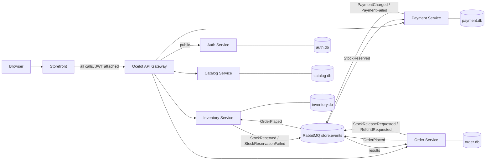

# StorePlatformCapstone
## Architecture



Every external call enters through the gateway. Each service owns its own database, and the order saga runs over RabbitMQ.

## Gateway & security (Module 8)

The **Ocelot gateway** is the only entry point. It validates the JWT issued by the **Auth service**, enforces roles, and adds an `X-Correlation-ID` to every request.

### Routes

| Path | Methods | Access |
|---|---|---|
| `/auth/v1/register` | POST | Public |
| `/auth/v1/login` | POST | Public, rate limited to 5 per minute per client (429) |
| `/catalog/v1/...` | GET | Public |
| `/catalog/v1/...` | POST, PUT, DELETE | Admin |
| `/inventory/v1/...` | GET | Logged-in users |
| `/inventory/v1/...` | POST, PUT, DELETE | Admin |
| `/orders/v1/...` | GET, POST, PUT, DELETE | Logged-in users (user ID forwarded as `X-User-Id`) |
| `/payments/v1/simulation` | GET, PUT | Logged-in users (simulate payment failure switch) |

A missing or invalid token returns **401**; a valid token without the required role returns **403**.

### Accounts

- **Admin:** seeded on startup from `ADMIN_EMAIL` / `ADMIN_PASSWORD` in `.env`.
- **Customers:** register through the Storefront (Create account) or `POST /auth/v1/register`.

### Configuration

Copy `.env.example` to `.env` before `docker compose up`. The Auth service and the gateway must share the same `JWT_KEY` (at least 32 characters), `JWT_ISSUER` and `JWT_AUDIENCE`. `.env` is git-ignored; no secrets are committed. For local `dotnet run`, set them with user-secrets:

```powershell
dotnet user-secrets set "Jwt:Key" "<at least 32 characters>" --project AuthService
dotnet user-secrets set "Jwt:Key" "<same key>" --project ApiGateway
dotnet user-secrets set "Seed:AdminEmail" "admin@store.local" --project AuthService
dotnet user-secrets set "Seed:AdminPassword" "<password>" --project AuthService
```

## Messaging (Module 4)

All events go through the topic exchange `store.events`. Every queue has a dead-letter queue (`<queue>.dlq`) bound to `store.dlx`, so failed messages are kept, never dropped.

| Queue | Owner | Handles |
|---|---|---|
| `inventory.order-placed` | Inventory | `OrderPlaced`: reserve stock for all lines, all or nothing |
| `inventory.stock-release` | Inventory | `StockReleaseRequested`: release reservations (compensation) |
| `payment.stock-reserved` | Payment | `StockReserved`: charge, or decline when the failure switch is on |
| `payment.refund` | Payment | `RefundRequested`: refund a charged order (compensation) |

- **Publisher confirms:** every publish waits for the broker's acknowledgement.
- **Manual ack:** consumers ack only after their database transaction commits; failures are nacked to the `.dlq`.
- **Idempotency:** each consuming service stores processed message IDs in a `ProcessedMessages` table, so a redelivered message is skipped.
- **Correlation:** the `X-Correlation-ID` travels in message headers and appears in every consumer log line.
- **Simulate payment failure:** `PUT /payments/v1/simulation` with `{"failPayments": true}` makes the next payment decline, which triggers compensation (stock released, order cancelled). No code edits or restarts needed.

## Troubleshooting

| Symptom | Cause and fix |
|---|---|
| Gateway returns **404** for every path | The gateway can't find its route file. Locally it uses `ocelot.Development.json`, in Docker `ocelot.json`; restart the gateway from the folder that contains them. |
| Every protected call returns **401**, even after login | The gateway and Auth service use different JWT keys, issuers or audiences. Make them match in `.env` or user-secrets. |
| Admin gets **403** | The token was issued before the account became admin, or the role claim is missing. Log out and log in again. |
| Login returns **429** | Rate limit: 5 login attempts per minute. Wait a minute. |
| Login or register returns **500** | Check the Auth service logs; on a clean start make sure `JWT_KEY` is set and at least 32 characters. |
| Service log says **RabbitMQ not ready** | The broker is still starting; services retry automatically. Locally, run `docker start rabbitmq`. |
| `PRECONDITION_FAILED` when declaring a queue | An old queue exists without dead-letter settings. Delete it in the RabbitMQ UI (http://localhost:15672) or run `docker compose down -v`. |
| Build fails with **MSB3027 / file in use** | A copy of the service is still running. Stop it (Ctrl+C) or run `Get-Process <ServiceName> | Stop-Process`. |
