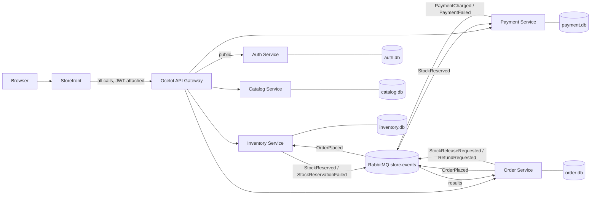

# StorePlatformCapstone

## Running the system

### Prerequisites

- **Docker Desktop** with the WSL 2 engine (shows "Engine running")
- **Git**
- **.NET 8 SDK**, only for local development without Docker

### Start everything with Docker (primary path)

```powershell
git clone https://github.com/chelxiesalongsongan/StorePlatformCapstone.git
cd StorePlatformCapstone
copy .env.example .env
docker compose up --build -d
docker compose ps
```

The first build takes several minutes. All containers should be running, with `rabbitmq` marked healthy. Configuration (JWT key, admin account, broker host, service URLs) comes from `.env` and environment variables; nothing is hard-coded.

### Port map

| What | URL / port | Notes |
|---|---|---|
| Storefront (UI) | http://localhost:5000 | Calls the system through the gateway only |
| API gateway | http://localhost:8080 | The single entry point for all API calls |
| RabbitMQ management | http://localhost:15672 | Login `guest` / `guest` |
| RabbitMQ (AMQP) | `localhost:5672` | |
| Catalog, Inventory, Order, Payment, Auth | port 8080 inside the Docker network only | Not published; reachable only through the gateway |

### Accounts

- **Admin:** `ADMIN_EMAIL` / `ADMIN_PASSWORD` from your `.env`, seeded on startup.
- **Customer:** use **Create account** in the Storefront.

### Walkthrough (acceptance flow)

1. Open http://localhost:5000 and browse products without logging in.
2. Create an account and log in.
3. Place an order: it moves from Pending to Stock reserved to **Confirmed** on its own page.
4. Click **Simulate payment failure**, then place another order: it ends **Cancelled**, and its stock is released.
5. Click **Stop simulating failure**.
6. As the customer, open http://localhost:5000/Admin/Stock and click **Apply**: the gateway answers 403 and the Storefront shows "Admins only". Anonymous API calls get 401.
7. Log in as the admin: **Stock** appears in the menu and changes are accepted.

### Stopping

- `docker compose down` stops everything.
- `docker compose down -v` also removes the broker's data, for a completely clean start.

### Local development without Docker (optional)

Start RabbitMQ with `docker run -d --name rabbitmq -p 5672:5672 -p 15672:15672 rabbitmq:3-management`, set the JWT and admin user-secrets (see Gateway & security below), then run each project with `dotnet run --project <path>`. Local ports: Storefront 5154, gateway 5284, Auth 5259, Catalog 5044, Inventory 5007, Order 5262, Payment 5212.

## Architecture



Every external call enters through the gateway. Each service owns its own database, and the order saga runs over RabbitMQ.

## Gateway & security (Module 8)

The **Ocelot gateway** is the only entry point. It validates the JWT issued by the **Auth service**, enforces roles, and adds an `X-Correlation-ID` to every request.

### Routes

| Path | Methods | Access |
|---|---|---|
| `/auth/v1/register` | POST | Public |
| `/auth/v1/login` | POST | Public, rate limited to 5 per minute per client (429) |
| `/catalog/v1/...` | GET | Public |
| `/catalog/v1/...` | POST, PUT, DELETE | Admin |
| `/inventory/v1/...` | GET | Logged-in users |
| `/inventory/v1/...` | POST, PUT, DELETE | Admin |
| `/orders/v1/...` | GET, POST, PUT, DELETE | Logged-in users (user ID forwarded as `X-User-Id`) |
| `/payments/v1/simulation` | GET, PUT | Logged-in users (simulate payment failure switch) |

A missing or invalid token returns **401**; a valid token without the required role returns **403**.

### Accounts

- **Admin:** seeded on startup from `ADMIN_EMAIL` / `ADMIN_PASSWORD` in `.env`.
- **Customers:** register through the Storefront (Create account) or `POST /auth/v1/register`.

### Configuration

Copy `.env.example` to `.env` before `docker compose up`. The Auth service and the gateway must share the same `JWT_KEY` (at least 32 characters), `JWT_ISSUER` and `JWT_AUDIENCE`. `.env` is git-ignored; no secrets are committed. For local `dotnet run`, set them with user-secrets:

```powershell
dotnet user-secrets set "Jwt:Key" "<at least 32 characters>" --project AuthService
dotnet user-secrets set "Jwt:Key" "<same key>" --project ApiGateway
dotnet user-secrets set "Seed:AdminEmail" "admin@store.local" --project AuthService
dotnet user-secrets set "Seed:AdminPassword" "<password>" --project AuthService
```

## Messaging (Module 4)

All events go through the topic exchange `store.events`. Every queue has a dead-letter queue (`<queue>.dlq`) bound to `store.dlx`, so failed messages are kept, never dropped.

| Queue | Owner | Handles |
|---|---|---|
| `inventory.order-placed` | Inventory | `OrderPlaced`: reserve stock for all lines, all or nothing |
| `inventory.stock-release` | Inventory | `StockReleaseRequested`: release reservations (compensation) |
| `payment.stock-reserved` | Payment | `StockReserved`: charge, or decline when the failure switch is on |
| `payment.refund` | Payment | `RefundRequested`: refund a charged order (compensation) |
| `order.stock-reserved` | Order | `StockReserved`: order moves to Stock reserved |
| `order.payment-charged` | Order | `PaymentCharged`: order moves to **Confirmed** |
| `order.stock-reservation-failed` | Order | `StockReservationFailed`: order moves to **Cancelled** (nothing was reserved) |
| `order.payment-failed` | Order | `PaymentFailed`: order moves to **Cancelled** and publishes `StockReleaseRequested` + `RefundRequested` |

- **Publisher confirms:** every publish waits for the broker's acknowledgement.
- **Manual ack:** consumers ack only after their database transaction commits; failures are nacked to the `.dlq`.
- **Idempotency:** each consuming service stores processed message IDs in a `ProcessedMessages` table, so a redelivered message is skipped.
- **Correlation:** the `X-Correlation-ID` travels in message headers and appears in every consumer log line.
- **Simulate payment failure:** `PUT /payments/v1/simulation` with `{"failPayments": true}` makes the next payment decline, which triggers compensation (stock released, order cancelled). No code edits or restarts needed.

## Troubleshooting

| Symptom | Cause and fix |
|---|---|
| Gateway returns **404** for every path | The gateway can't find its route file. Locally it uses `ocelot.Development.json`, in Docker `ocelot.json`; restart the gateway from the folder that contains them. |
| Every protected call returns **401**, even after login | The gateway and Auth service use different JWT keys, issuers or audiences. Make them match in `.env` or user-secrets. |
| Admin gets **403** | The token was issued before the account became admin, or the role claim is missing. Log out and log in again. |
| Login returns **429** | Rate limit: 5 login attempts per minute. Wait a minute. |
| Login or register returns **500** | Check the Auth service logs; on a clean start make sure `JWT_KEY` is set and at least 32 characters. |
| Service log says **RabbitMQ not ready** | The broker is still starting; services retry automatically. Locally, run `docker start rabbitmq`. |
| `PRECONDITION_FAILED` when declaring a queue | An old queue exists without dead-letter settings. Delete it in the RabbitMQ UI (http://localhost:15672) or run `docker compose down -v`. |
| Build fails with **MSB3027 / file in use** | A copy of the service is still running. Stop it with Ctrl+C, or end the process in Task Manager. |
| `docker` says it **cannot connect to the Docker API** | Docker Desktop isn't running. Start it and wait for "Engine running". |
| `docker compose up` says a **port is already allocated** | Something else uses 5000, 8080, 5672 or 15672, often a manually started `rabbitmq` container. Run `docker stop rabbitmq` and `docker rm rabbitmq`, then try again. |
| A container shows **Exited** in `docker compose ps` | Read its error with `docker compose logs --tail 30 <service>`. If it says the JWT key is missing, check that `.env` exists (copy it from `.env.example`). |
| An order stays **Pending** | A consumer isn't running. Check `docker compose logs inventory-service payment-service order-service` and the queues at http://localhost:15672. |

## Eventual consistency

Each service owns its own database, so placing an order cannot be one transaction across services. The saga makes the system **eventually consistent** instead. These are the places where data is temporarily out of step, and why that's acceptable here:

- **Order status.** `POST /orders/v1/orders` returns 202 with the order **Pending**. It becomes Confirmed or Cancelled a moment later, after Inventory and Payment have reacted to the events. The Storefront's order page shows the status and refreshes until the order is finished, so the customer always sees where it stands.
- **Stock after a failed payment.** When a payment is declined, the stock stays reserved until Inventory processes `StockReleaseRequested`, typically well under a second later. During that window another order could see slightly less stock than is really available, which is a safe direction to be wrong in.
- **Refunds.** A refund is applied when Payment processes `RefundRequested`, after the order is already Cancelled.
- **Catalog stock figure.** The stock number shown on the products page comes from the Catalog service, while Inventory is the source of truth for reservations. The Catalog figure is informational and is not updated by each order.

Why this is acceptable:

- Every saga step is a **local transaction** in one service's database, so no service is ever left half-updated.
- **Publisher confirms**, **manual acks**, **idempotent consumers** (the `ProcessedMessages` tables) and **dead-letter queues** mean an event is never silently lost or applied twice.
- Failures always end in an explicit **Cancelled** state with a reason, and compensation (release stock, refund) runs automatically.
- A distributed transaction across five services would couple them tightly and make each depend on the others being up, which defeats the point of separate services.

Known limitation: a service publishes its event right after committing its transaction. If it crashed in between, that event would be missing and the order would stay Pending; a transactional outbox would close this gap and is a natural next step.